<div align="center">

# ⚡ Smart Grid Virtual Substation Manager

**A desktop app for creating, monitoring and managing virtual electrical substations,<br>built with Python, CustomTkinter and object-oriented design.**


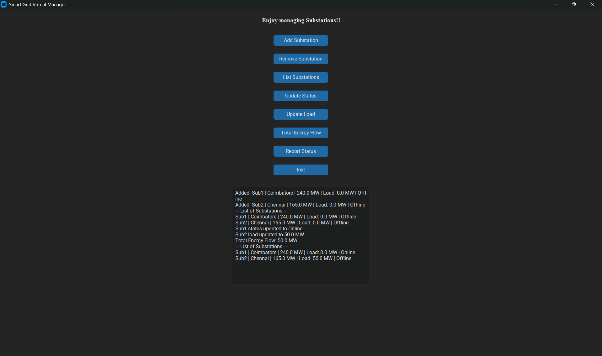

</div>

---

## 🎯 At a glance

| | |
|---|---|
| **What it is** | A lightweight desktop simulation of a substation registry for a small grid |
| **What you can do** | Add, remove, list and inspect substations, change their status and load, total the load and print a status report |
| **Built with** | Python · CustomTkinter (dark theme) · Tkinter message boxes · file I/O |
| **Core idea** | Each substation is a **Python object**. A manager object owns the collection, and a GUI object talks to the manager |
| **Persistence** | One line per substation in a local `data.txt` file, reloaded automatically on startup |
| **Safety checks** | Rejects loads above rated capacity and warns above 80 % loading |

> **Scope:** This is a *software-level* management tool, not a SCADA system or a power-flow solver. Load and status values are typed in by the user, and **"Total Energy Flow" is the sum of the stored loads**, not a physical network calculation.

---

## ✨ Features

| | Feature | What happens |
|:-:|---|---|
| ➕ | **Add Substation** | Enter name, location and capacity (MW). A new `Substation` object is created and saved immediately. |
| 🗑️ | **Remove Substation** | Enter a name. The matching object is deleted and the file is rewritten. |
| 📋 | **List Substations** | Prints every substation as `Name \| Location \| Capacity \| Load \| Status`. |
| 🔄 | **Update Status** | Set a substation to `Online`, `Offline` or another state. |
| ⚡ | **Update Load** | Set the current load in MW, with a capacity check and an 80 % warning. |
| 📊 | **Total Energy Flow** | Adds up `current_load` across all substations. |
| 📑 | **Report Status** | Prints a short `name: status` summary for every substation. |
| 💾 | **Auto-save / auto-load** | Every change is written to `data.txt`, and the file is read back on the next launch. |

---

## 🎬 Demo walkthrough

The screenshots follow one complete session, from an empty app to a final cleanup.

<table>
<tr>
<td width="50%">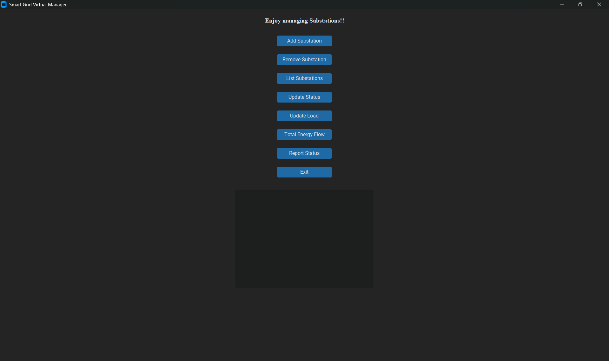</td>
<td width="50%">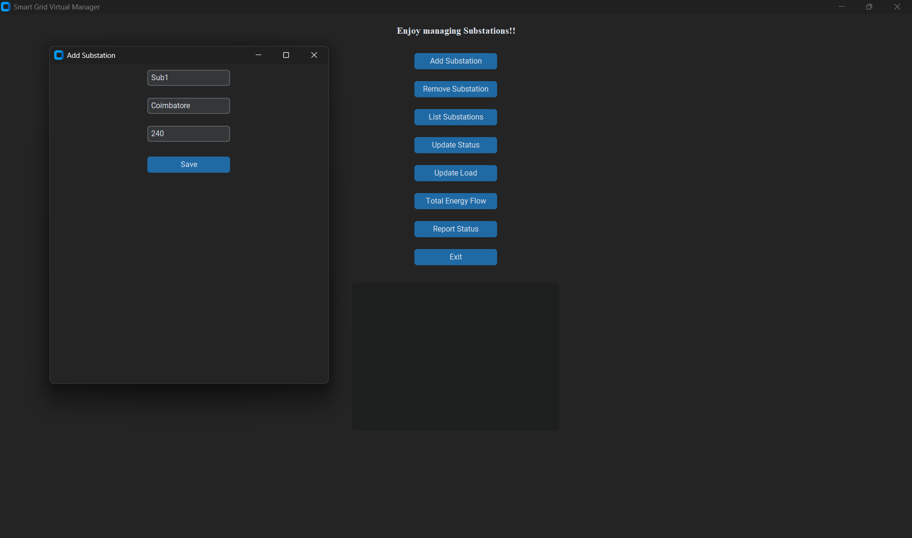</td>
</tr>
<tr>
<td align="center"><b>① Launch</b>: eight action buttons and an output console</td>
<td align="center"><b>② Add Sub1</b>: Coimbatore, 240 MW</td>
</tr>
<tr>
<td>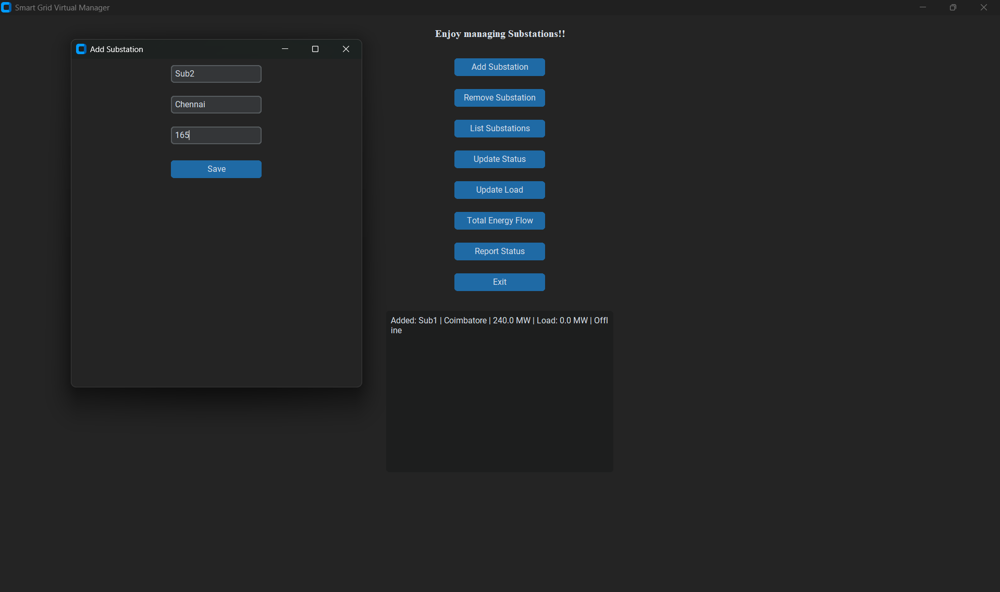</td>
<td>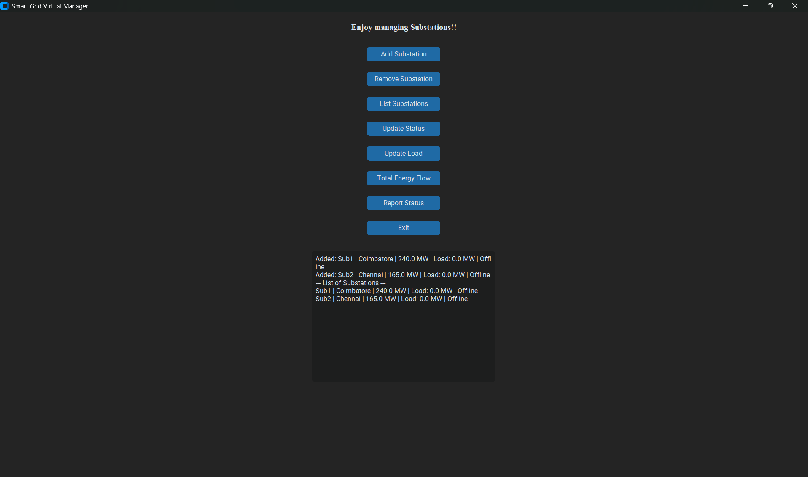</td>
</tr>
<tr>
<td align="center"><b>③ Add Sub2</b>: Chennai, 165 MW</td>
<td align="center"><b>④ List</b>: both start at 0 MW and Offline</td>
</tr>
<tr>
<td>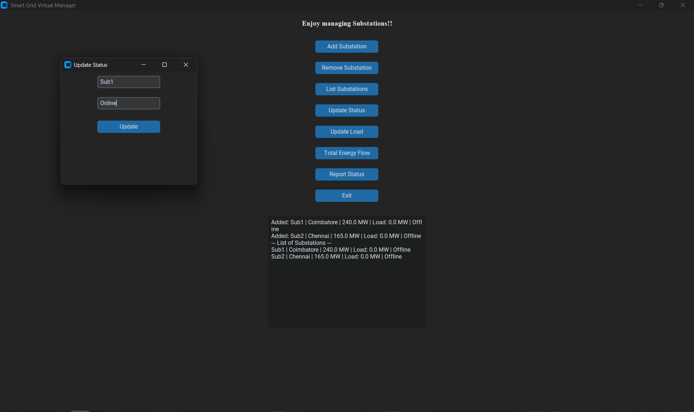</td>
<td>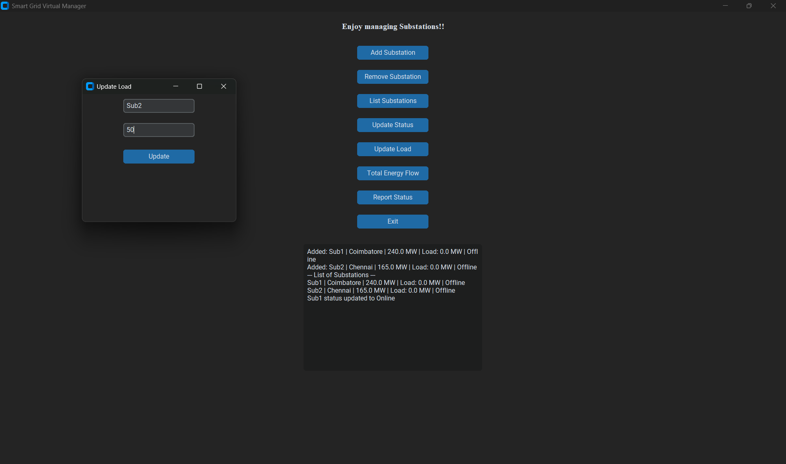</td>
</tr>
<tr>
<td align="center"><b>⑤ Update status</b>: Sub1 → Online</td>
<td align="center"><b>⑥ Update load</b>: Sub2 → 50 MW</td>
</tr>
<tr>
<td>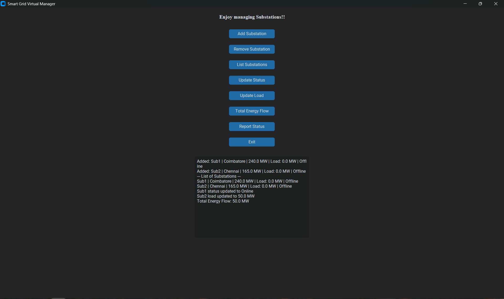</td>
<td></td>
</tr>
<tr>
<td align="center"><b>⑦ Total energy flow</b>: 0 + 50 = 50.0 MW</td>
<td align="center"><b>⑧ List again</b>: both updates are visible</td>
</tr>
<tr>
<td>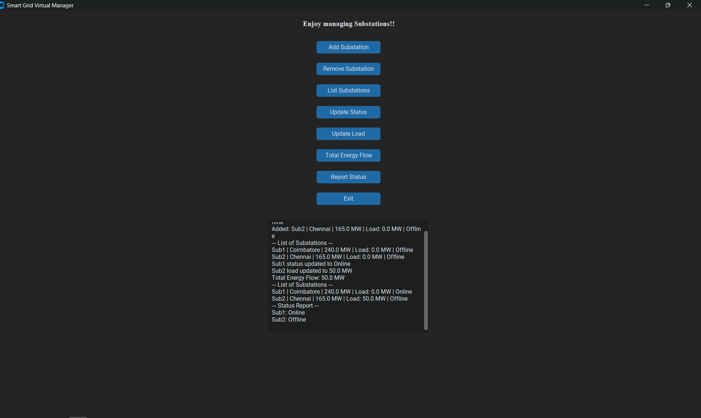</td>
<td>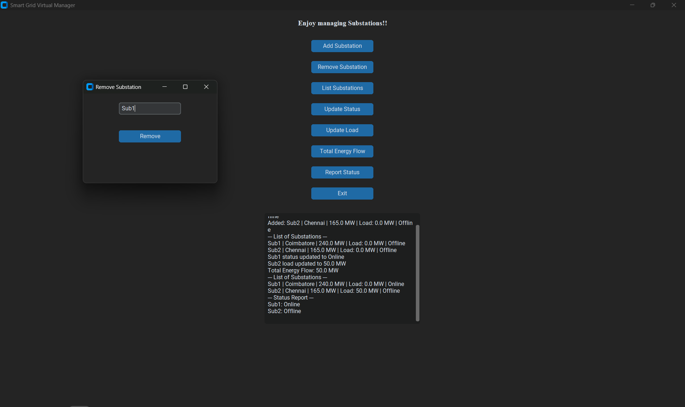</td>
</tr>
<tr>
<td align="center"><b>⑨ Status report</b>: Sub1 Online, Sub2 Offline</td>
<td align="center"><b>⑩ Remove</b>: delete Sub1</td>
</tr>
<tr>
<td colspan="2" align="center">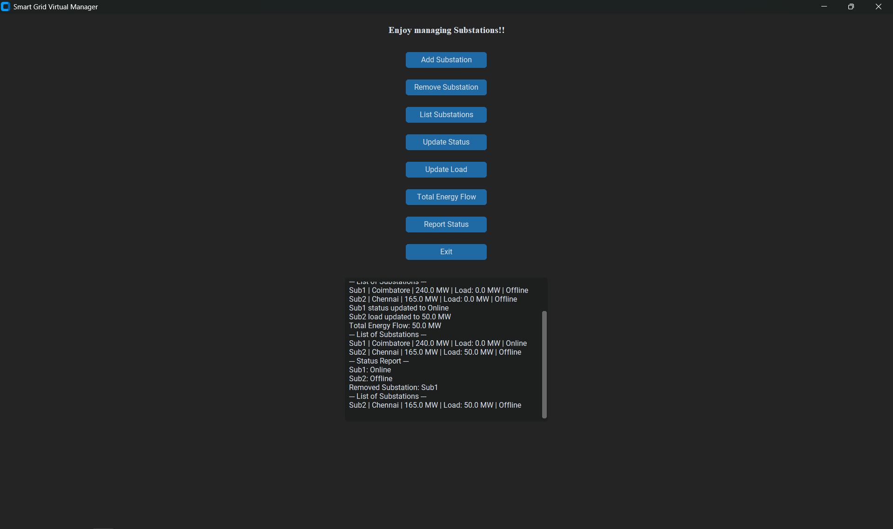<br><b>⑪ Final list</b>: only Sub2 (Chennai, 50 MW) remains</td>
</tr>
</table>

Step-by-step notes are in [`docs/OUTPUT_WALKTHROUGH.md`](docs/OUTPUT_WALKTHROUGH.md).

---

## 🧱 How it's built

### Three classes, three responsibilities

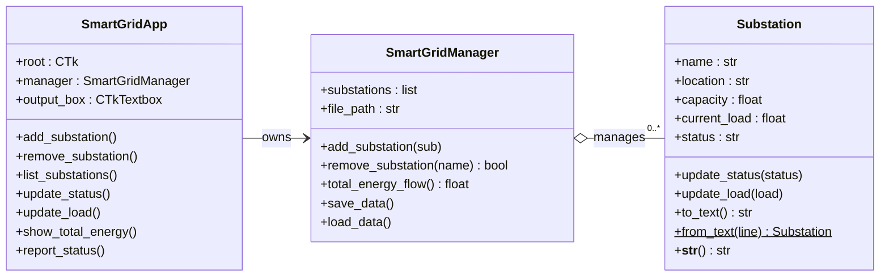

| Layer | Class | Role |
|---|---|---|
| 🖥️ Presentation | `SmartGridApp` | Builds the window and pop-ups, reads user input, shows results and errors |
| 🧠 Logic | `SmartGridManager` | Holds the list of substations, adds and removes them, computes totals, saves and loads |
| 🔌 Model | `Substation` | Stores one substation's state and the rules for changing it (capacity check, 80 % warning) |
| 💾 Storage | `data.txt` | Plain-text file, one comma-separated line per substation |

All three classes live in a single file, [`src/Proj2.py`](src/Proj2.py), but each one keeps to its own responsibility. More detail is in [`docs/OBJECT_ORIENTED_DESIGN.md`](docs/OBJECT_ORIENTED_DESIGN.md).

### What happens when you click a button

```
 [ Button click ]  ─▶  SmartGridApp opens a pop-up and reads the fields
                              │
                              ▼
                      Convert / validate input  ──✗──▶  messagebox error
                              │ ✓
                              ▼
            SmartGridManager / Substation updates object state
                              │
                              ▼
                   save_data()  ─▶  data.txt rewritten
                              │
                              ▼
                 Result printed in the output console
```

---

## 🛡️ Validation rules

| Situation | Check in code | User sees |
|---|---|---|
| Capacity is not a number | `float()` raises `ValueError` | ❌ *Enter valid capacity (number).* |
| Load is not a number | `float()` raises `ValueError` | ❌ *Enter valid load (number).* |
| Load > rated capacity | `load <= self.capacity` fails | ❌ *Load exceeds capacity for \<name\>!* (load unchanged) |
| Load > 80 % of capacity | `current_load > 0.8 * capacity` | ⚠️ *Load on \<name\> exceeds 80% capacity!* (load accepted) |
| Name not found | No match in the list | ❌ *Substation not found.* |
| Corrupt line in `data.txt` | `from_text()` raises `ValueError` | Line skipped with a console message; the app still starts |

**Example with Sub2 (165 MW):** 50 MW is accepted silently, 140 MW is accepted with a warning (> 132 MW), and 200 MW is rejected.

The full logic for each feature is in [`docs/FEATURES_AND_LOGIC.md`](docs/FEATURES_AND_LOGIC.md).

---

## 💾 Data format

Every change rewrites `data.txt` in the working directory:

```text
name,location,capacity,current_load,status
```

```text
Sub1,Coimbatore,240.0,0.0,Online
Sub2,Chennai,165.0,50.0,Offline
```

- **Save:** `save_data()` writes `to_text()` for every object.
- **Load:** On startup, `load_data()` rebuilds each object with the class method `Substation.from_text()`, skipping blank or malformed lines.

A ready-made example is in [`data/sample_data.txt`](data/sample_data.txt). See [`data/README.md`](data/README.md).

---

## 🚀 Run it

```bash
git clone https://github.com/<your-username>/smart-grid-virtual-substation-manager.git
cd smart-grid-virtual-substation-manager

python -m pip install -r requirements.txt     # Windows: py -m pip install -r requirements.txt
python src/Proj2.py                           # Windows: py src/Proj2.py
```

**Requirements:** Python 3 with Tkinter (included in the standard Windows and macOS installers; on Linux install `python3-tk`) and CustomTkinter.

💡 To start with demo data, copy `data/sample_data.txt` to `data.txt` in the folder you run the app from.

### Try this 60-second scenario

| Step | Action | Expected output |
|:-:|---|---|
| 1 | Add `Sub1`, `Coimbatore`, `240` | `Added: Sub1 \| Coimbatore \| 240.0 MW \| Load: 0.0 MW \| Offline` |
| 2 | Add `Sub2`, `Chennai`, `165` | `Added: Sub2 \| Chennai \| 165.0 MW \| …` |
| 3 | Update status: `Sub1` → `Online` | `Sub1 status updated to Online` |
| 4 | Update load: `Sub2` → `50` | `Sub2 load updated to 50.0 MW` |
| 5 | Total Energy Flow | `Total Energy Flow: 50.0 MW` |
| 6 | Report Status | `Sub1: Online` / `Sub2: Offline` |
| 7 | Remove `Sub1`, then List | Only `Sub2` remains |
| 8 | *Bonus:* update `Sub2` load to `140`, then `200` | 80 % warning, then over-capacity error |

---

## 🎓 Concepts demonstrated

| OOP principle | Where it appears |
|---|---|
| **Encapsulation** | A substation's data and the rules for changing it live together in `Substation` |
| **Abstraction** | The GUI never touches the file format; it only calls `SmartGridManager` methods |
| **Composition** | `SmartGridApp` *has a* manager, and the manager *has many* substations |
| **Class method / alternate constructor** | `Substation.from_text()` builds an object from a stored line |
| **Special (dunder) method** | `__str__()` gives the readable one-line display used in the console |
| **Serialisation** | `to_text()` and `from_text()` round-trip objects to plain text |

It also covers **event-driven GUI programming**, **exception handling**, **file I/O**, **input validation** and **threshold-based monitoring**.

---

## 🐞 Known quirks

These are honest notes on the current behaviour. Each would make a good small improvement.

- **Rejected loads still print a success line.** If a load above capacity is rejected, the error pops up, but the console also prints *"load updated to X MW"* even though the value didn't change.
- **Status is free text.** Any string is accepted, not only `Online` and `Offline`.
- **Duplicate names are allowed.** Remove and update act on the first match only.
- **Commas break storage.** A comma in a name or location produces a line that is skipped on the next load.
- **No range check.** Negative capacity or load values are accepted.
- **`data.txt` location** depends on the folder the app is launched from.

---

## 🔮 Roadmap ideas

- 📈 Live load bar or chart per substation, coloured by loading %
- 🔽 Drop-down for status and a list picker for substation names
- 🗄️ SQLite or JSON storage instead of comma-separated text
- 📤 Export reports to CSV or PDF
- 🕒 Load history with timestamps and basic forecasting
- 🌐 MQTT or IoT inputs for live (or simulated) readings
- ⚙️ An actual power-flow model for a small network topology

---

## 📁 Repository layout

```
smart-grid-virtual-substation-manager/
├── src/
│   └── Proj2.py                    # the whole application (3 classes)
├── data/
│   ├── README.md                   # data file format
│   └── sample_data.txt             # demo data (Sub1, Sub2)
├── docs/
│   ├── OBJECT_ORIENTED_DESIGN.md   # class responsibilities & relationships
│   ├── FEATURES_AND_LOGIC.md       # what each button does, step by step
│   └── OUTPUT_WALKTHROUGH.md       # annotated screenshot sequence
├── images/output/                  # 01–11 demo screenshots
├── requirements.txt
└── .gitignore                      # ignores the runtime data.txt
```

---

<div align="center">

**Academic mini project** · Smart Grid · Power Systems · Python GUI · Object-Oriented Programming

</div>
